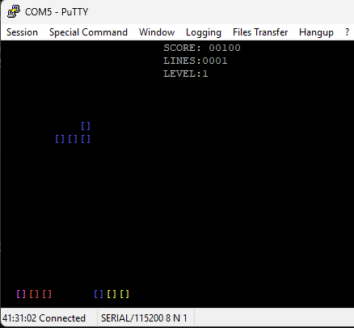

# 🎮 Tetris 6502 + SID 6581

Un clásico juego de Tetris implementado en **C89 estricto** para el procesador **6502** corriendo sobre el monitor para fpga tang nano 9k, con efectos de sonido generados por el chip **SID 6581**. Diseñado para ejecutarse en la FPGA **Tang Nano 9K** con monitor ROM personalizado.



## ✨ Características

- 🎵 **Audio SID 6581**: Música de introducción y efectos de sonido auténticos
- 🎲 **Generación aleatoria real**: Usa el registro de ruido del SID para secuencias únicas
- 🎯 **SRS (Super Rotation System)**: Sistema de rotación oficial de Tetris con wall-kicks
- 🎨 **Colores ANSI brillantes**: Interfaz visual atractiva en terminal
- ⚡ **Optimizado para 6502**: Código eficiente en C89 estricto compatible con CC65
- **Controles completos**: Movimiento, rotación horaria/antihoraria, hard drop y soft drop

## 🛠️ Especificaciones Técnicas

### Hardware Objetivo
- **CPU**: MOS 6502 @ 3.375MHz
- **Audio**: SID 6581 ($D400)
- **Plataforma**: Tang Nano 9K FPGA
- **Display**: Terminal ANSI compatible

### Software
- **Compilador**: CC65 (`cl65`)
- **Lenguaje**: C89 estricto + ensamblador inline
- **Dependencias**: `romapi.h` (proporcionada por el monitor ROM)

##  Requisitos

### Para Compilar
- [CC65](https://cc65.github.io/) compilador cruzado para 6502
- Make (en Windows: incluido con Git Bash o MSYS2)
- Conexión serial al dispositivo Tang Nano 9K

### Para Ejecutar
- Tang Nano 9K con monitor ROM cargado
- Terminal compatible con ANSI escape codes
- Conexión serial configurada (115200 baudios recomendado)

## 🚀 Instalación y Compilación

1. **Clonar el repositorio**:
```bash
git clone https://github.com/nelsama/tetris_4mon.git
cd tetris_4mon
```

2. **Compilar**:
```bash
make
```

Si `cl65`, `ca65` y `ld65` no están en el `PATH`, indica la instalación de CC65:

```bash
# Linux / macOS
make CC65_HOME=/opt/cc65

# Windows (barras normales)
make CC65_HOME=D:/cc65
```

3. **Resultado**:

| Archivo | Descripción |
|---|---|
| `output/tetris.bin` | Binario para cargar en `$0800` |
| `output/tetris.map` | Mapa de memoria y símbolos |

### Otros comandos

```bash
make info    # tamaño del binario
make map     # mapa de memoria
make clean   # borra build/ y output/
make help    # ayuda
```

> En Windows, `make` detecta automáticamente si se ejecuta desde Git Bash/MSYS2
y usa `cmd.exe` para las recetas. No hace falta pasar `SHELL=cmd.exe`.

## 🕹️ Ejecución en la Tang Nano 9K

1. Copiar `output/tetris.bin` a la tarjeta SD.
2. En el monitor del Tang Nano 9K:
```
LOAD tetris.bin 0800
R 0800
```

### Arranque automático

Para que el juego arranque al encender, crea un archivo `BOOT.INI` en la SD
con el nombre del binario:

```
tetris.bin
```

El monitor lo cargará en `$0800` y lo ejecutará automáticamente.

- `Q` reinicia el monitor **sin** autoboot (prompt del monitor)
- `QB` reinicia el monitor **con** autoboot (relee `BOOT.INI`)

### Controles

| Tecla | Acción |
|---|---|
| `A` / `←` | Mover izquierda |
| `D` / `→` | Mover derecha |
| `S` / `↓` | Bajar una fila (soft drop) |
| `W` / `↑` | Rotar horario |
| `Z` | Rotar antihorario |
| `Espacio` | Hard drop |
| `ESC` | Salir al monitor |
| `R` / `E` | Reiniciar / salir (en Game Over) |

## 🧠 Mapa de memoria

El programa se enlaza contra `none.lib` de CC65: toda la entrada/salida se hace
por la ROM del monitor (`romapi.h`, jump table en `$BF00`). La configuración del
linker está en `config/programa.cfg`.

| Rango | Uso |
|---|---|
| `$0002`-`$001F` | Variables del monitor (reservado) |
| `$0020`-`$007F` | Zero page del programa |
| `$0100`-`$01FF` | Stack hardware del 6502 |
| `$0800`-`$3F9F` | Código, rodata, data y bss |
| `$3FA0`-`$3FFD` | Software stack de CC65 (`c_sp`) |
| `$3FFE`-`$3FFF` | Flag de AUTOBOOT del monitor (reservado) |
| `$BF00` | Jump table de la ROM |
| `$C000`+ | ROM del monitor |

## 📁 Estructura del proyecto

```
tetris_4mon/
├── config/
│   └── programa.cfg     # Configuración del linker
├── include/
│   └── romapi.h         # API de la ROM del monitor
├── src/
│   ├── main.c           # Lógica del juego
│   └── startup.s        # Arranque del runtime CC65
├── makefile
└── README.md
```
